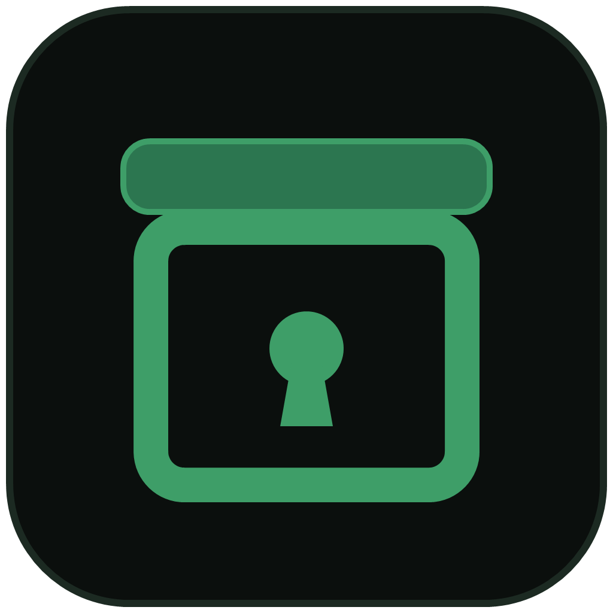

<p align="center">
  
</p>

<h1 align="center">SealBox</h1>

<p align="center">
  <strong>Keep passwords, API keys and personal data out of your source files,<br>so AI coding agents never see them.</strong>
</p>

<p align="center">
  <a href="https://pypi.org/project/sealbox/"></a>
  <a href="https://pypi.org/project/sealbox/"></a>
  <a href="https://marketplace.visualstudio.com/items?itemName=gokhanozdemir.sealbox"></a>
  <a href="https://open-vsx.org/extension/gokhanozdemir/sealbox"></a>
  <a href="https://github.com/gokhanozdemir-git/SealBox/actions/workflows/ci.yml"></a>
  <a href="LICENSE"></a>
</p>

<p align="center"><b>English</b> · <a href="README.tr.md">Türkçe</a></p>

---

AI coding agents such as GitHub Copilot, Claude Code and Cursor read your files straight from
disk and send what they read to a cloud model. A `.env` file, a hard-coded database password
or a customer's e-mail address in a fixture goes along with it.

SealBox **takes those secrets out of your files for good**. Each value moves into an
encrypted, per-project vault, and the code is rewritten to read an environment variable. When
you run your program through SealBox, the values are handed over as environment variables,
only after you approve, and they are hidden again in the program's output.

<!-- Screenshot: docs/images/hero.gif (seal a file from the editor, end to end)
<p align="center"></p>
-->

```python
# before                                   # after `sealbox seal`
DB_PASSWORD = "Tr0ub4dor&3"                 DB_PASSWORD = os.environ["DB_PASSWORD"]
ADMIN_EMAIL = "ayse@example.com"            ADMIN_EMAIL = "__SECURE_EMAIL_9f2c…__"
```

## Features

- **Finds secrets** in Python, JavaScript/TypeScript, Java, `.env`, JSON/YAML/TOML and more:
  passwords, tokens, API keys (OpenAI, Anthropic, AWS, GitHub, Stripe, Google, Slack…),
  private keys, JWTs, credentials inside URLs, e-mail addresses, phone numbers, IBANs,
  credit card numbers and Turkish national IDs. Matches are confirmed by checksums
  (Luhn, IBAN mod-97, ID algorithm) to keep false positives low.
- **Moves them into an encrypted vault** (AES-256-GCM). The key lives in your OS credential
  store (Windows Credential Manager, macOS Keychain, Linux Secret Service), never on disk.
- **Rewrites your code** to read environment variables, and redacts personal data with
  placeholders. Works the same for every agent and every editor.
- **Runs your program with the secrets** after an approval dialog that also flags recently
  changed lines that could leak a secret (network calls, file writes, encoded prints).
- **Hides secrets in program output**, including common encodings (base64, URL, JSON).
- **Shares the vault with your team** through their GitHub SSH keys; no extra server.
- **Recovers a lost key** with a one-time recovery code, optionally split into 2-of-3 shares.
- **Guards git**: scans history for values that were committed before sealing, and installs a
  pre-commit hook that stops a vault value from being committed.
- **VS Code extension**: squiggles on exposed secrets, quick fixes, hovers, a status bar item
  and a "Run with Vault" command. Also available for Cursor, Windsurf and VSCodium via Open VSX.
- English and Turkish interface.

## Install

SealBox needs **Python 3.12 or newer**.

```sh
pipx install sealbox          # recommended: isolated install
# or
python -m pip install sealbox
```

On Linux, the approval dialog uses Tk: `sudo apt install python3-tk` (Debian/Ubuntu).

For the editor integration, install the extension from the
[VS Code Marketplace](https://marketplace.visualstudio.com/items?itemName=gokhanozdemir.sealbox)
or [Open VSX](https://open-vsx.org/extension/gokhanozdemir/sealbox).

## Quick start

```sh
cd my-project
sealbox init                       # checks the project and tells you what to do next
sealbox seal --check               # list exposed secrets (changes nothing; exit code 1 if any)
sealbox seal                       # move them into the vault and rewrite the files
sealbox recovery setup             # one-time recovery code, in case the key is ever lost
sealbox hook install               # stop vault values from being committed by accident
sealbox exec -- python app.py      # run with the secrets (an approval dialog opens)
git add .sealbox && git commit -m "Add SealBox vault"
```

`exec` works with any language, because every runtime reads environment variables:

```sh
sealbox exec -- npm start
sealbox exec -- java Main.java
sealbox exec -- mvn spring-boot:run
```

Help is always one command away:

```sh
sealbox                  # grouped list of commands
sealbox help seal        # details and examples for one command
sealbox status           # vault, key, recovery and team health, with a fix for each problem
sealbox --lang tr ...    # Turkish output (or SEALBOX_LANG=tr); default follows the OS language
```

## How it works

```
 file ──► SafeFS ──► Scanner ──► Sealer ──────────► file (os.environ["X"] / __SECURE_..__)
          path and    regex +     move to vault /        │
          symlink     validators  redact                 ▼
          checks                                .sealbox/project.vault (AES-256-GCM)
                                                key: OS credential store / SSH / recovery code
 exec ──► approval dialog ──► secrets as environment variables ──► program (output filtered)
```

| What was found | What SealBox does |
|---|---|
| Password, token or API key that is a whole string literal (`.py`, `.js`, `.ts`, `.java`…) | Moved to the vault; becomes `os.environ["DB_PASSWORD"]`, `process.env.DB_PASSWORD` or `System.getenv("DB_PASSWORD")` |
| The same value repeated in a comment | Replaced with a placeholder |
| E-mail, phone number, IBAN, national ID, listed person names | Replaced with a placeholder (not needed at run time). If the program does use it, `sealbox vault expose` turns it into an environment variable |
| `.env` | Secret lines move to the vault; `.env` is replaced by `.env.sealed`, which holds placeholders only |
| JSON / YAML / TOML config file | Redacted; the report tells you which environment variable the app should read |
| Part of a larger string (e.g. inside a URL) or an unsupported language | **Left untouched** and reported with `[!]`: move it by hand |

Sealing the same file again never duplicates vault entries: the same value always maps to the
same record. Run `seal` from the project root; from a subfolder it stops if a parent folder has
a `.env`, a `.git` or a vault, so nothing above it stays exposed (use `-w .` to override).

### Managing the vault

```sh
sealbox vault list                        # names and placeholders only, never values
sealbox vault reveal DB_PASSWORD          # show a value (approval required)
sealbox vault set DB_PASSWORD             # change or add a value (typed, not echoed)
sealbox vault expose __SECURE_EMAIL_…__   # pass redacted data to the program at run time
sealbox vault remove --unused             # delete records no file references any more
```

### The approval dialog

Every `exec` and `vault reveal` opens a dialog that shows the command and the variables it
will receive. It also lists **lines changed since your last approval that touch a secret and**:

- **send it out** (requests, fetch, curl…), which SealBox cannot hide;
- **write it to a file**, which SealBox cannot hide either;
- **print it transformed** (base64, reversed…), which the output filter may not recognise;
- **print it**: the known value is hidden on screen, but still flagged.

If any of the first three is present, **Allow** stays disabled for three seconds so it is not
clicked out of habit. Only short digests of lines are stored for this comparison, in
`.sealbox/last_run.json`, which is never committed. There is deliberately **no flag or
environment variable that skips approval**: an agent could use it too.

## Team sharing and recovery

If the vault key existed in only one place, losing that place (a Windows reset, a new laptop)
would make the vault impossible to open. So the key (DEK) has several independent locks:

```
recovery code (128 bits) ─Argon2id (64 MiB, t=3, p=4)─► recovery KEK = X25519 key ─┐
teammate's GitHub SSH key (ed25519 → X25519, or RSA-OAEP) ─────────────────────────┼─► DEK ─► vault
OS credential store (cache) ───────────────────────────────────────────────────────┘
```

```sh
# Team: the vault is committed; only team members' GitHub accounts can open it
sealbox team init --github my-name        # this computer's SSH key must be on that account
sealbox team add teammate                 # fetches keys from github.com/teammate.keys
sealbox team add teammate --owner         # owners can add and remove people too
sealbox team remove teammate              # rotates the DEK; they cannot open the new vault
sealbox team list

# Recovery: the code is only ever shown in a dialog, never in the terminal
sealbox recovery setup                    # create the code (one per user)
sealbox recovery shares                   # split it into 2-of-3 Shamir shares
sealbox recovery restore                  # bring the key back with the code or 2 shares
sealbox recovery export D:\project.sealkit          # kit: locked DEK + encrypted vault
sealbox recovery restore --kit D:\project.sealkit   # when the vault folder is gone too
sealbox vault reset                       # last resort: new empty vault, old one kept aside
```

- **Unlock order:** OS credential store, then (with a team) your SSH key, then an error that
  points to recovery. After a teammate pulls, the first open asks for their SSH passphrase and
  caches the key.
- **Committed:** `project.vault`, `project.names`, `project.masked`, `team.json`. The vault's
  own `.gitignore` keeps backups and locks out.
- **team.json** is protected by a MAC derived from the DEK: someone who can push but does not
  know the DEK cannot add a fake member or role.
- **Unencrypted SSH keys are refused**, because any program (agents included) could read them.

## Git history and the commit hook

Cleaning a file does not clean history: a secret committed before sealing is still readable in
old commits.

```sh
sealbox history          # search the whole git history for vault values
sealbox hook install     # pre-commit hook: stop a commit that contains a vault value
sealbox hook uninstall
```

`history` searches added lines in `git log --all -p` for every vault value and its common
encodings, and reports the name, commit and file, never the value. If a commit also exists on
a remote branch, it is marked as pushed: that value may already be in someone else's hands, so
**rotate it at the provider**; rewriting history is not enough.

The hook checks `git diff --cached` and stops the commit with `file:line`. It is a seat belt
against accidents, not a policy: `git commit --no-verify` skips it.

## Configuration

Copy [`sealbox.example.toml`](sealbox.example.toml) to your project root as `sealbox.toml`
(or pass `--config`).

| Setting | Default | Description |
|---|---|---|
| `excludes` | `.env`, `*.pem`, `*.key`, `id_rsa*`, `.git/**`, `.venv/**`, `node_modules/**`, `.ssh/**`… | Sensitive or generated paths that are never scanned or written (`.env` is handled separately) |
| `explicit_includes` | `[]` | Opt back in to an excluded path |
| `max_file_bytes` | 512 KiB | Larger files are skipped |
| `scanner.person_names` | `[]` | Names to redact (names cannot be detected reliably with regex) |
| `scanner.custom_rules`, `disabled_rules`, `allow_values` | | Add rules, turn rules off, silence false positives |

## Security model

**SealBox protects against** the everyday leak it was built for: an agent (or a person, or a
screenshot) reading a file and sending its contents somewhere else. Secrets are not on disk,
and the vault is useless without its key.

**What SealBox shows:** file paths, categories and counts, line and column numbers, variable
names, placeholders and error types. **What it never shows:** secret values (except in the
approval-gated reveal dialog), the vault key, the recovery code and its shares (dialog only),
or messages of third-party exceptions (type name only).

**Known limits:**

- A deliberately malicious agent running under your user account could try to read the OS
  credential store directly. The output filter does not catch reversed or split values; the
  approval dialog is the real safeguard.
- Regular expressions cannot find every secret. Unusual formats, values split across strings
  or encoded values may be missed. Review the report and add `custom_rules` where needed.
- Name detection only covers names you list.
- Python cannot guarantee that memory is wiped; keys are zeroed after use on a best-effort basis.
- Removing a teammate rotates the key, but they may remember values they have seen;
  `team remove` lists them so you can rotate them.

Found a vulnerability? Please follow [SECURITY.md](SECURITY.md) instead of opening an issue.

## Contributing

Bug reports and pull requests are welcome. See [CONTRIBUTING.md](CONTRIBUTING.md) for the
development setup, the project layout and how to add a translation.

## License

SealBox is licensed under the [Functional Source License, Version 1.1, ALv2 Future License](LICENSE)
(FSL-1.1-ALv2). You may use, modify and redistribute it for any purpose **except offering a
competing commercial product or service**. Internal use at your company, education and research
are explicitly allowed. Two years after each release, that release also becomes available under
the Apache License 2.0.
