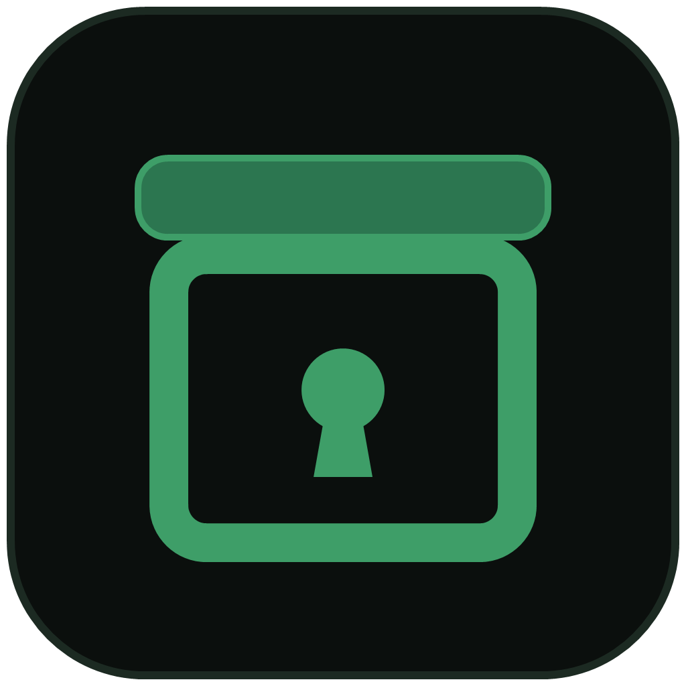

<p align="center">
  
</p>

<h1 align="center">SealBox</h1>

<p align="center">
  <strong>Parolaları, API anahtarlarını ve kişisel verileri kaynak dosyalarınızdan çıkarır;<br>yapay zekâ kodlama ajanları onları hiç görmez.</strong>
</p>

<p align="center"><a href="README.md">English</a> · <b>Türkçe</b></p>

---

GitHub Copilot, Claude Code, Cursor gibi kodlama ajanları dosyalarınızı doğrudan diskten okur
ve okuduklarını buluttaki modele gönderir. Bir `.env` dosyası, koda gömülü bir veritabanı
parolası ya da test verisindeki bir müşteri e-postası da onlarla birlikte gider.

SealBox bu sırları **dosyalardan kalıcı olarak çıkarır**. Her değer projeye özel, şifreli bir
kasaya taşınır; kod, değeri ortam değişkeninden okuyacak şekilde yeniden yazılır. Programı
SealBox üzerinden çalıştırdığınızda değerler yalnızca sizin onayınızdan sonra ortam değişkeni
olarak verilir ve programın çıktısında yine gizlenir.

```python
# önce                                     # `sealbox seal` sonrası
DB_PASSWORD = "Tr0ub4dor&3"                 DB_PASSWORD = os.environ["DB_PASSWORD"]
ADMIN_EMAIL = "ayse@example.com"            ADMIN_EMAIL = "__SECURE_EMAIL_9f2c…__"
```

## Özellikler

- **Sırları bulur:** Python, JavaScript/TypeScript, Java, `.env`, JSON/YAML/TOML ve daha
  fazlasında parola, token, API anahtarı (OpenAI, Anthropic, AWS, GitHub, Stripe, Google,
  Slack…), özel anahtar, JWT, URL içindeki kimlik bilgisi, e-posta, telefon, IBAN, kredi kartı
  ve T.C. kimlik numarası. Eşleşmeler sağlama algoritmalarıyla (Luhn, IBAN mod-97, TCKN)
  doğrulanır; yanlış alarm az olur.
- **Şifreli kasaya taşır** (AES-256-GCM). Anahtar diskte değil, işletim sisteminin kimlik
  deposundadır (Windows Kimlik Bilgisi Yöneticisi, macOS Anahtar Zinciri, Linux Secret Service).
- **Kodu yeniden yazar:** değer ortam değişkeninden okunur, kişisel veriler yer tutucuyla
  karalanır. Her ajan ve her editör için aynı şekilde çalışır.
- **Programı sırlarla çalıştırır:** onay penceresi, son onaydan beri değişen ve sır
  sızdırabilecek satırları da gösterir (ağa gönderme, dosyaya yazma, dönüştürüp yazdırma).
- **Program çıktısında sırları gizler**, yaygın kodlamalar dahil (base64, URL, JSON).
- **Kasayı ekiple paylaşır:** ekip arkadaşlarının GitHub SSH anahtarlarıyla, ek sunucu gerekmez.
- **Kaybolan anahtarı kurtarır:** tek seferlik kurtarma kodu, istenirse 2-of-3 parçaya bölünür.
- **Git'i korur:** kasaya taşınmadan önce commit edilmiş değerleri geçmişte bulur; kasadaki bir
  değerin commit'e girmesini durduran pre-commit kancası kurar.
- **VS Code eklentisi:** açık sırların altını çizer, hızlı düzeltme, üzerine gelince bilgi,
  durum çubuğu ve "Kasayla çalıştır" komutu sunar. Open VSX sayesinde Cursor, Windsurf ve
  VSCodium'da da çalışır.
- Türkçe ve İngilizce arayüz.

## Kurulum

SealBox **Python 3.12 veya üstü** gerektirir.

```sh
pipx install sealbox          # önerilen: ayrık kurulum
# ya da
python -m pip install sealbox
```

Linux'ta onay penceresi Tk kullanır: `sudo apt install python3-tk` (Debian/Ubuntu).

Editör entegrasyonu için eklentiyi
[VS Code Marketplace](https://marketplace.visualstudio.com/items?itemName=gokhanozdemir.sealbox)
ya da [Open VSX](https://open-vsx.org/extension/gokhanozdemir/sealbox) üzerinden kurun.

## 5 dakikada başla

```sh
cd projem
sealbox init                       # projeyi kontrol eder, sıradaki adımları söyler
sealbox seal --check               # açık sırları listeler (hiçbir şeyi değiştirmez; varsa çıkış kodu 1)
sealbox seal                       # sırları kasaya taşır, dosyaları yeniden yazar
sealbox recovery setup             # anahtar kaybolursa diye kurtarma kodu (bir kez)
sealbox hook install               # kasadaki bir değer yanlışlıkla commit edilmesin
sealbox exec -- python app.py      # programı sırlarla çalıştır (onay penceresi açılır)
git add .sealbox && git commit -m "SealBox kasası"
```

`exec` her dille çalışır, çünkü her çalışma ortamı ortam değişkenlerini okur:

```sh
sealbox exec -- npm start
sealbox exec -- java Main.java
sealbox exec -- mvn spring-boot:run
```

Yardım her zaman bir komut uzakta:

```sh
sealbox                  # komutların gruplu listesi
sealbox help seal        # bir komutun ayrıntısı ve örnekleri
sealbox status           # kasa, anahtar, kurtarma ve ekip durumu; her sorunun yanında çözümü
sealbox --lang en ...    # İngilizce (ya da SEALBOX_LANG=en); varsayılan işletim sistemi dili
```

## Nasıl çalışır

```
 dosya ──► SafeFS ──► Scanner ──► Sealer ──────────► dosya (os.environ["X"] / __SECURE_..__)
           yol/symlink  regex +     kasaya taşı /          │
           kontrolü     doğrulayıcı karala                 ▼
                                                .sealbox/project.vault (AES-256-GCM)
                                                anahtar: kimlik deposu / SSH / kurtarma kodu
 exec ──► onay penceresi ──► sırlar ortam değişkeni olarak ──► program (çıktısı süzülür)
```

| Ne bulundu | Ne yapılır |
|---|---|
| Tam bir string literal olan parola / token / API anahtarı (`.py`, `.js`, `.ts`, `.java`…) | Kasaya taşınır; `os.environ["DB_PASSWORD"]`, `process.env.DB_PASSWORD` ya da `System.getenv("DB_PASSWORD")` olur |
| Aynı değerin yorumdaki tekrarı | Yer tutucuyla karalanır |
| E-posta, telefon, IBAN, TCKN, listelenen isimler | Yer tutucuyla karalanır (çalışma anında gerekmez). Program kullanıyorsa `sealbox vault expose` ile ortam değişkeni olur |
| `.env` | Gizli satırlar kasaya taşınır; `.env` silinir, yerine yalnızca yer tutucu içeren `.env.sealed` gelir |
| JSON / YAML / TOML ayar dosyası | Karalanır; uygulamanın değeri hangi ortam değişkeninden okuması gerektiği raporlanır |
| Daha büyük bir metnin parçası (ör. URL içinde) ya da desteklenmeyen dil | **Dokunulmaz**, `[!]` ile raporlanır: elle taşınmalı |

Aynı dosyayı tekrar karalamak kasada kopya oluşturmaz: aynı değer her zaman aynı kayda bağlanır.
`seal` komutunu proje kökünden çalıştırın. Alt klasörden çalıştırılırsa ve üstte `.env`, `.git`
ya da kasa varsa durur, böylece üstteki dosyalar açıkta kalmaz (`-w .` ile aşabilirsiniz).

### Kasayı yönetmek

```sh
sealbox vault list                        # yalnızca adlar ve etiketler, değerler asla
sealbox vault reveal DB_PASSWORD          # bir değeri göster (onay gerekir)
sealbox vault set DB_PASSWORD             # değeri değiştir ya da ekle (ekranda görünmez)
sealbox vault expose __SECURE_EMAIL_…__   # karalanmış veriyi programa çalışırken ver
sealbox vault remove --unused             # hiçbir dosyanın kullanmadığı kayıtları sil
```

### Onay penceresi

Her `exec` ve `vault reveal` bir pencere açar: komut ve verilecek değişkenler görünür. Pencere
ayrıca **son onaydan beri değişen, sırra dokunan ve şunlardan birini yapan satırları** listeler:

- **dışarı gönderiyor** (requests, fetch, curl…): SealBox bunu gizleyemez;
- **dosyaya yazıyor**: SealBox bunu da gizleyemez;
- **dönüştürüp yazdırıyor** (base64, ters çevirme…): çıktı süzgeci tanımayabilir;
- **yazdırıyor**: bilinen değer ekranda gizlenir, yine de gösterilir.

İlk üçünden biri varsa **İzin ver** düğmesi 3 saniye kapalı kalır, alışkanlıkla basılmasın diye.
Karşılaştırma için satırların kendisi değil, yalnızca kısa özetleri `.sealbox/last_run.json`
dosyasına yazılır; bu dosya repoya girmez. Onayı atlatan bir bayrak ya da ortam değişkeni
**bilinçli olarak yoktur**: ajan da onu kullanabilirdi.

## Ekip paylaşımı ve kurtarma

Kasa anahtarı tek bir yerde dursaydı, o yer kaybolduğunda (Windows sıfırlama, yeni bilgisayar)
kasa açılamazdı. Bu yüzden anahtarın (DEK) birden fazla bağımsız kilidi vardır:

```
kurtarma kodu (128 bit) ─Argon2id (64 MiB, t=3, p=4)─► kurtarma KEK'i = X25519 anahtarı ─┐
ekip arkadaşının GitHub SSH anahtarı (ed25519 → X25519 ya da RSA-OAEP) ──────────────────┼─► DEK ─► kasa
işletim sistemi kimlik deposu (önbellek) ────────────────────────────────────────────────┘
```

```sh
# Ekip: kasa repoya girer, değerleri yalnızca ekipteki GitHub hesapları açabilir
sealbox team init --github benim-adim     # bu bilgisayarın SSH anahtarı o hesapta olmalı
sealbox team add arkadasim                # github.com/arkadasim.keys adresinden anahtarı alır
sealbox team add arkadasim --owner        # sahip: o da kişi ekleyip çıkarabilir
sealbox team remove arkadasim             # DEK yenilenir; eski üye yeni kasayı açamaz
sealbox team list

# Kurtarma: kod yalnızca pencerede gösterilir, terminale asla yazılmaz
sealbox recovery setup                    # kodu üret (kullanıcı başına tek kod)
sealbox recovery shares                   # kodu 2-of-3 Shamir parçasına böl
sealbox recovery restore                  # kod ya da 2 parçayla anahtarı geri getir
sealbox recovery export D:\proje.sealkit            # kit: kilitli DEK + şifreli kasa
sealbox recovery restore --kit D:\proje.sealkit     # kasa klasörü de gittiyse
sealbox vault reset                       # son çare: yeni boş kasa, eskisi kenara kaldırılır
```

- **Kilit açma sırası:** kimlik deposu, sonra (ekip varsa) SSH anahtarı, sonra kurtarmayı
  öneren bir hata. Arkadaşınız pull ettikten sonra ilk açılışta SSH şifresi sorulur, anahtar
  önbelleğe alınır.
- **Repoya girenler:** `project.vault`, `project.names`, `project.masked`, `team.json`.
  Kasanın kendi `.gitignore` dosyası yedekleri ve kilitleri dışarıda bırakır.
- **team.json** DEK'ten türetilen bir MAC ile korunur: repoya yazabilen ama DEK'i bilmeyen biri
  sahte üye ya da rol ekleyemez.
- **Şifresiz SSH anahtarı reddedilir**, çünkü ajanlar dahil her program onu okuyabilir.

## Git geçmişi ve commit kancası

Dosyayı temizlemek geçmişi temizlemez: kasaya taşınmadan önce commit edilmiş bir sır eski
commit'lerde okunabilir.

```sh
sealbox history          # kasadaki değerleri tüm git geçmişinde ara
sealbox hook install     # pre-commit kancası: kasadaki bir değer commit'e girerse durdur
sealbox hook uninstall
```

`history`, `git log --all -p` çıktısında eklenen satırlarda her kasa değerini ve yaygın
kodlanmış hâllerini arar; değeri değil, yalnızca adı, commit'i ve dosyayı raporlar. Commit bir
uzak dalda da varsa "gönderilmiş" yazar: o değer artık başkasının elinde olabilir, **sırrı
servisinden yenileyin**; geçmişi yeniden yazmak yetmez.

Kanca `git diff --cached` çıktısına bakar ve commit'i `dosya:satır` bilgisiyle durdurur.
Kazaya karşı bir emniyet kemeridir, kural değildir: `git commit --no-verify` onu atlar.

## Yapılandırma

[`sealbox.example.toml`](sealbox.example.toml) dosyasını proje köküne `sealbox.toml` olarak
kopyalayın (ya da `--config` verin).

| Ayar | Varsayılan | Açıklama |
|---|---|---|
| `excludes` | `.env`, `*.pem`, `*.key`, `id_rsa*`, `.git/**`, `.venv/**`, `node_modules/**`, `.ssh/**`… | Hiç taranmayan ve yazılmayan hassas ya da üretilmiş yollar (`.env` ayrıca ele alınır) |
| `explicit_includes` | `[]` | Hariç tutulan bir yolu bilerek dahil etmek için |
| `max_file_bytes` | 512 KiB | Bundan büyük dosyalar atlanır |
| `scanner.person_names` | `[]` | Karalanacak isimler (isimler regex ile güvenilir bulunamaz) |
| `scanner.custom_rules`, `disabled_rules`, `allow_values` | | Kural ekleme, kapatma, yanlış alarmı susturma |

## Güvenlik modeli

**SealBox'ın kapattığı risk:** bir ajanın (ya da bir kişinin, bir ekran görüntüsünün) dosyayı
okuyup içeriğini başka bir yere göndermesi. Sırlar diskte değildir; kasa anahtarsız işe yaramaz.

**Gösterdikleri:** dosya yolları, kategori adları ve sayıları, satır/sütun, değişken adları,
yer tutucular ve hata türleri. **Asla göstermedikleri:** gizli değerler (yalnızca onaylı
gösterme penceresinde), kasa anahtarı, kurtarma kodu ve parçaları (yalnızca pencerede), dış
kütüphanelerin hata mesajları (yalnızca tür adı).

**Bilinen sınırlar:**

- Sizin hesabınızla çalışan, kasıtlı olarak kötü niyetli bir ajan işletim sistemi kimlik
  deposunu doğrudan okumaya çalışabilir. Çıktı süzgeci ters çevrilmiş ya da parçalanmış değeri
  yakalamaz; asıl koruma onay penceresidir.
- Regex her sırrı bulamaz. Sıra dışı biçimler, parçalara bölünmüş ya da kodlanmış değerler
  kaçabilir. Raporu inceleyin, gerekirse `custom_rules` ekleyin.
- İsim tespiti yalnızca listelediğiniz isimleri kapsar.
- Python belleğin kesin silindiğini garanti edemez; anahtarlar kullanım sonrası en iyi çabayla
  sıfırlanır.
- Ekipten çıkarılan kişi için anahtar yenilenir, ama daha önce gördüğü değerleri hatırlıyor
  olabilir; `team remove` bu değerleri listeler, onları yenileyin.

Bir güvenlik açığı mı buldunuz? Lütfen issue açmak yerine [SECURITY.md](SECURITY.md)
adımlarını izleyin.

## Katkı

Hata bildirimleri ve pull request'ler memnuniyetle karşılanır. Geliştirme ortamı, proje yapısı
ve çeviri ekleme için [CONTRIBUTING.md](CONTRIBUTING.md) dosyasına bakın.

## Lisans

SealBox, [Functional Source License, Version 1.1, ALv2 Future License](LICENSE) (FSL-1.1-ALv2)
ile lisanslanmıştır. **Rakip bir ticari ürün ya da hizmet sunmak dışında** her amaçla
kullanabilir, değiştirebilir ve dağıtabilirsiniz. Şirket içi kullanım, eğitim ve araştırma
açıkça serbesttir. Her sürüm, yayımlanmasından iki yıl sonra Apache License 2.0 ile de
kullanılabilir hâle gelir.
